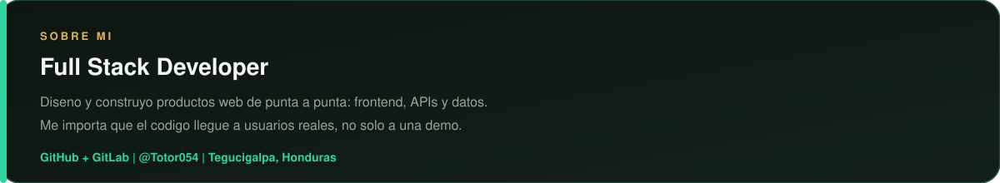
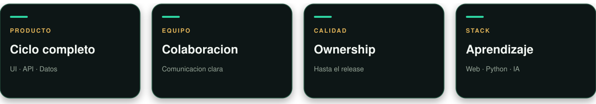
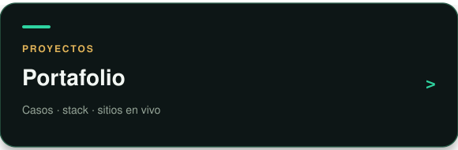
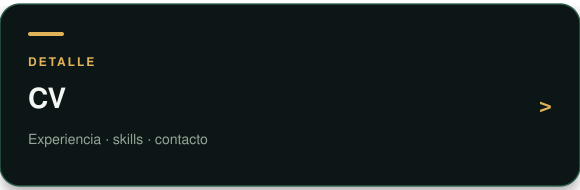
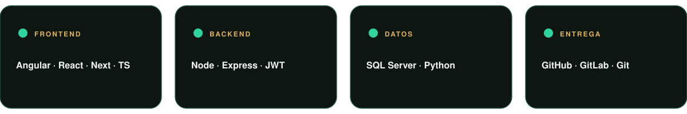
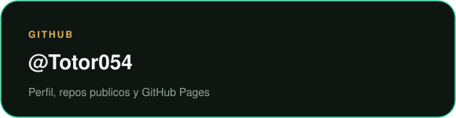

  

 

  
  &nbsp;
  
  &nbsp;
  
  &nbsp;
  
  &nbsp;
  

 

  

 

  

 

  

### Enfoque

  

### Proyectos y detalle tecnico

  
  &nbsp;
  

  

### Stack

  

 

  

  

### Codigo en GitHub y GitLab

  
  &nbsp;
  

  

### Contacto

  
  &nbsp;
  
  &nbsp;
  
  &nbsp;
  

 

  
  &nbsp;
  

 

  
  &nbsp;
  

 

  

